# Painelux

**Painel de gestão que junta um pet spa e um marketplace de beleza num só lugar**, com dados reais
de dois produtos publicados: KPIs com comparação de período, funil de contato, mapa de oferta e demanda dos
96 distritos de São Paulo, insights gerados por regras, controle de acesso por papel e auditoria completa.

### [▶ Abrir o Painelux](https://painelux.vercel.app) · entre com **um clique** em “Explorar a demonstração”

> Projeto fictício desenvolvido para portfólio por Victoria Fernandes Vieira.
> Fontes dos dados: [Pelagem Studio](https://pelagem-studio.vercel.app) (pet spa) e
> [Lírio](https://lirio-estetica.vercel.app) (profissionais de beleza em SP), dois projetos meus, também fictícios.
> [English version below](#english).

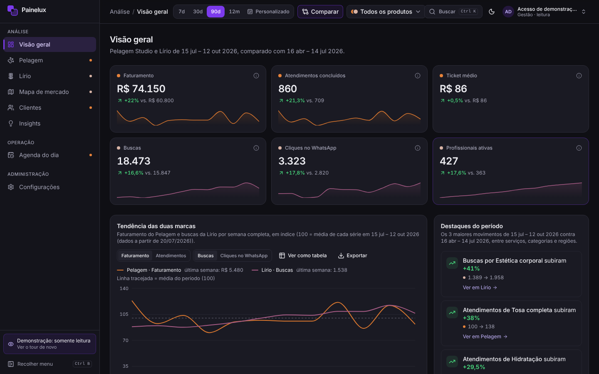

## Acesso para quem vem do portfólio

1. Abra **https://painelux.vercel.app**.
2. Clique em **Explorar a demonstração**. A conta abre no perfil **Gestão, somente leitura**, e as credenciais
   também aparecem na própria tela.
3. Um tour de 5 passos mostra os filtros, o menu e o atalho `Ctrl+K`. Dá para revê-lo pelo botão
   “Demonstração: somente leitura” na barra lateral.

A conta de demonstração vê todos os dashboards e exporta gráficos, mas não altera nada. As telas da
administração (Usuários, Logs, Sincronização) aparecem nas capturas abaixo.

## O que o projeto demonstra

| Competência | Onde ver |
| --- | --- |
| **Análise de dados** | KPIs contra o período anterior, tendência indexada das duas marcas, faturamento semanal, mapa de calor dia × hora, funil buscas → perfis → WhatsApp com queda entre etapas, categorias em alta, ranking de distritos por conversão, índice de demanda por distrito e categoria, 11 regras de insights |
| **Segurança** | RBAC verificado no servidor em toda página, rota e Server Action; bloqueio após 5 tentativas; sessão de 8 h; auditoria com IP e navegador; CSP e headers de segurança; nenhum dado pessoal armazenado; CSV protegido contra injeção de fórmulas |
| **Integração** | Clientes HTTP das duas APIs com `x-api-key`, paginação, 3 tentativas com espera crescente e validação Zod item a item; gravação idempotente; cron diário e botão “Sincronizar agora” com histórico |

## Telas

| | |
| --- | --- |
| 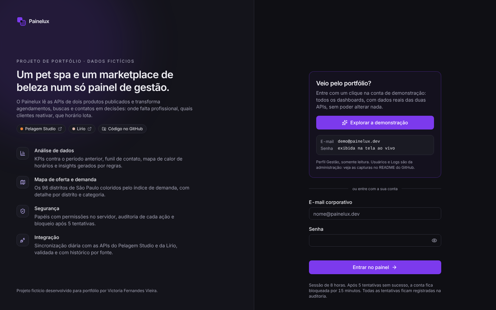 **Entrada**: apresentação e acesso de um clique | 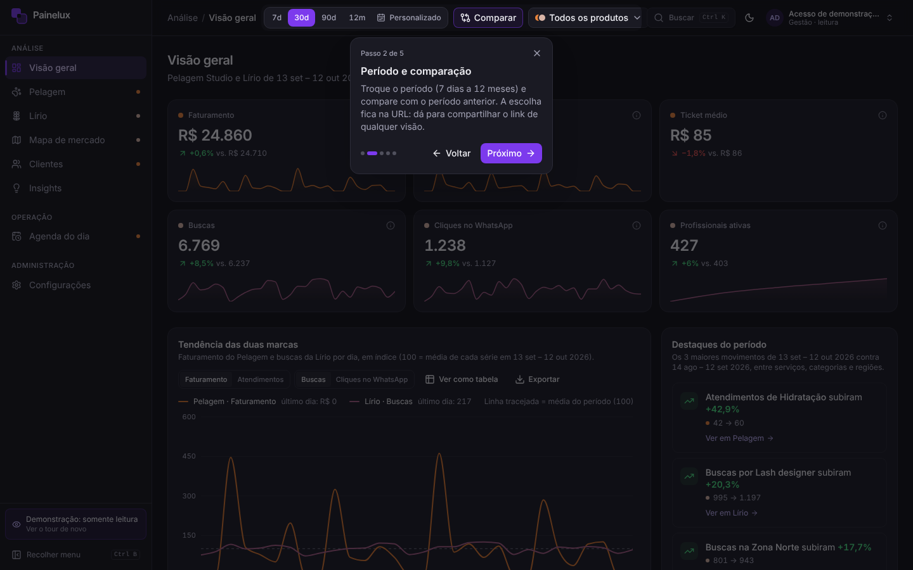 **Tour guiado** na primeira visita |
| 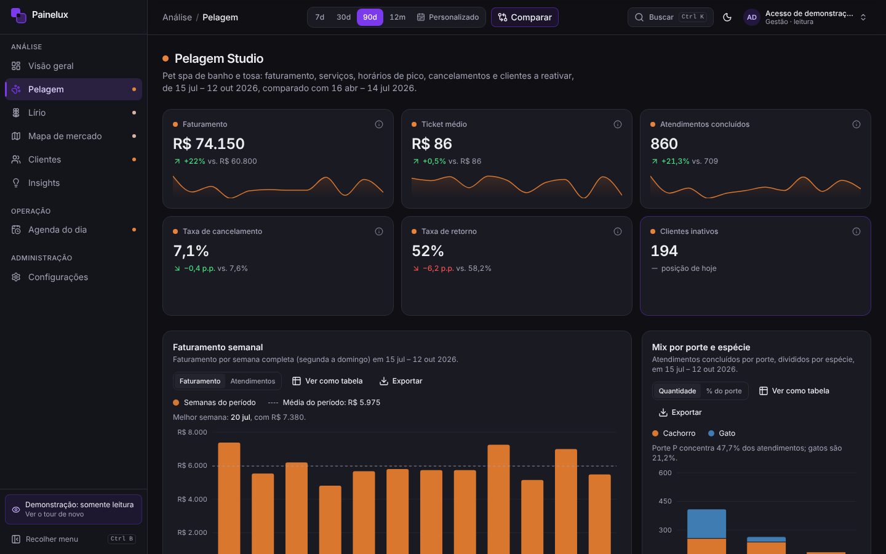 **Pelagem**: KPIs, faturamento semanal, mix por porte e espécie | 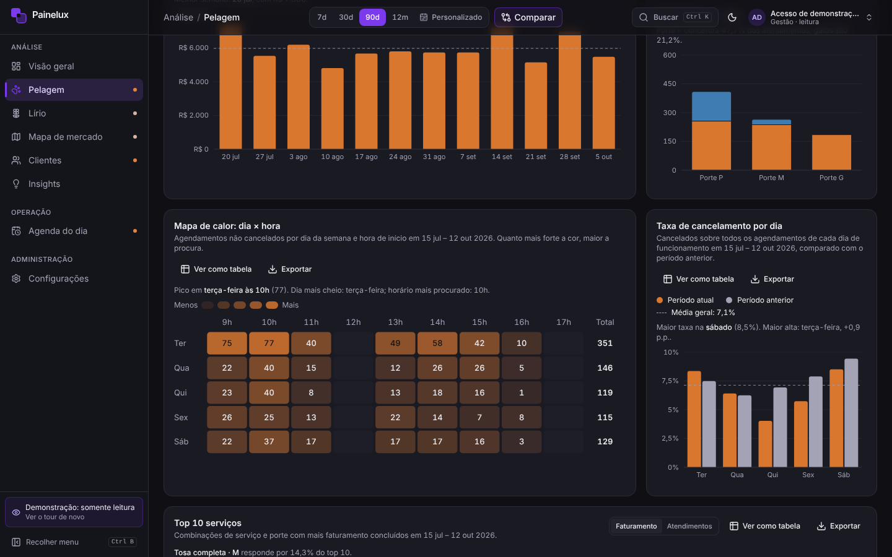 **Mapa de calor dia × hora** e cancelamento por dia |
| 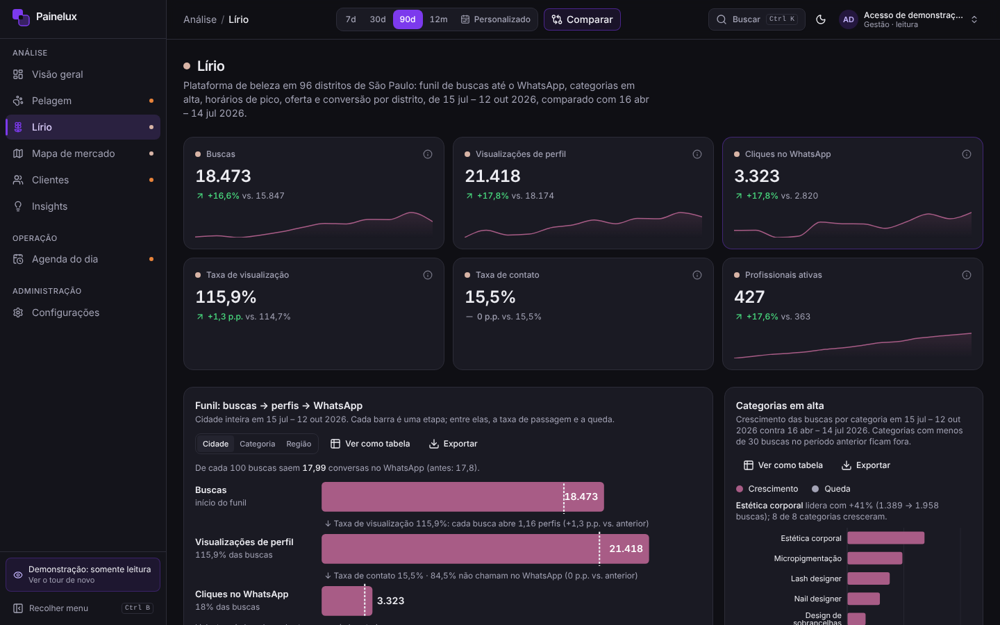 **Lírio**: funil com queda entre etapas e categorias em alta | 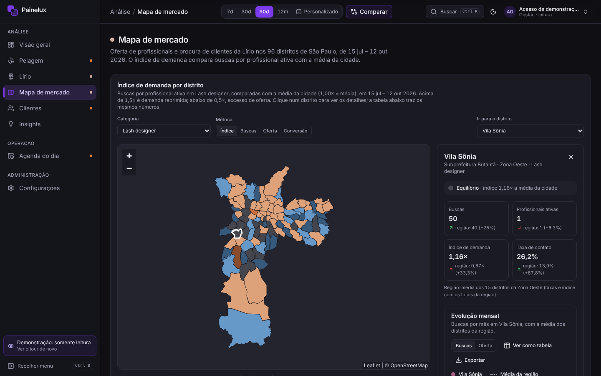 **Mapa de mercado**: índice de demanda nos 96 distritos |
| 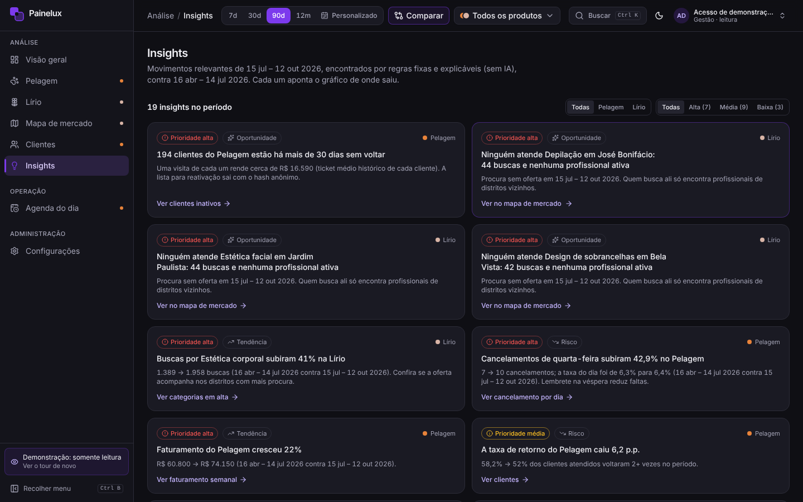 **Insights** por regras, com link para o gráfico de origem | 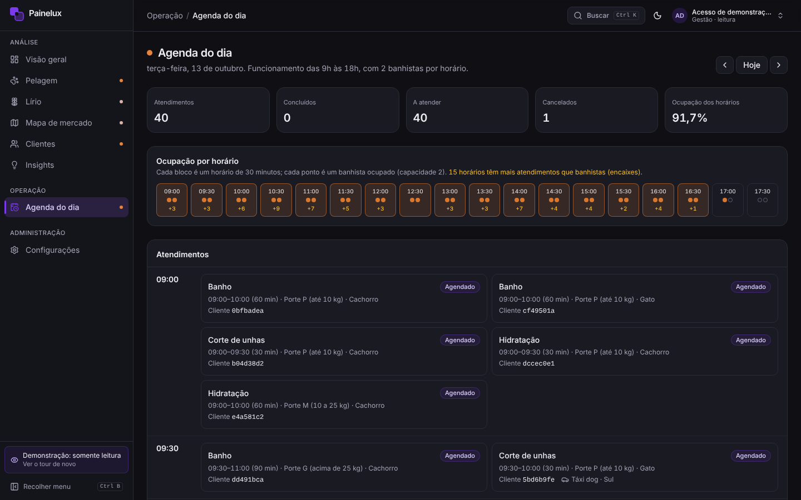 **Agenda do dia** do atendimento, sem valores financeiros |
| 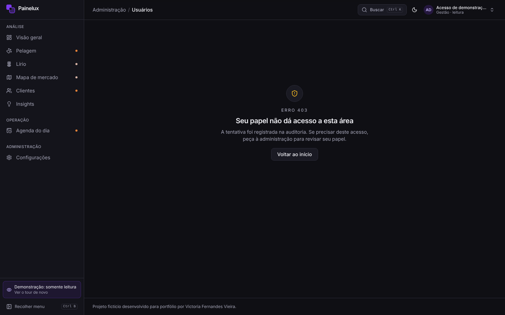 **Usuários** (ADMIN) e matriz de permissões |  **Logs de auditoria** filtráveis com exportação CSV |
| 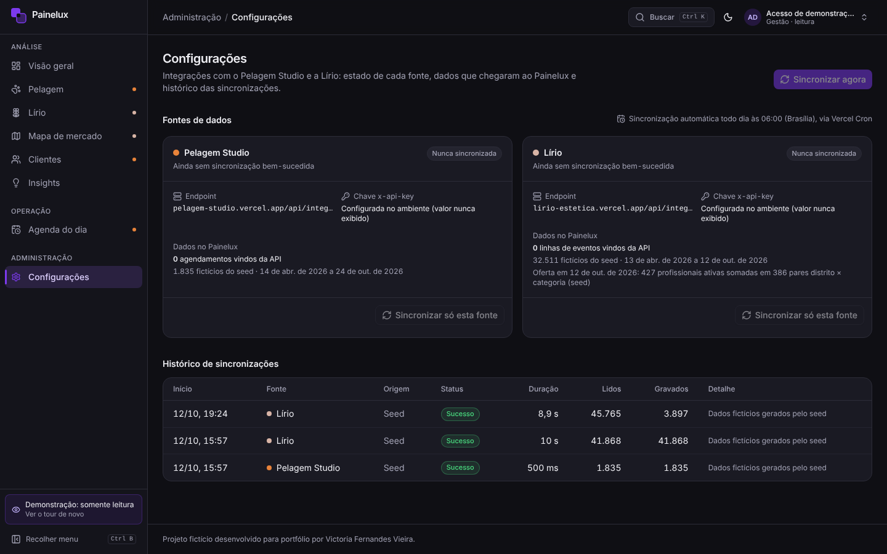 **Sincronização** por fonte com histórico | 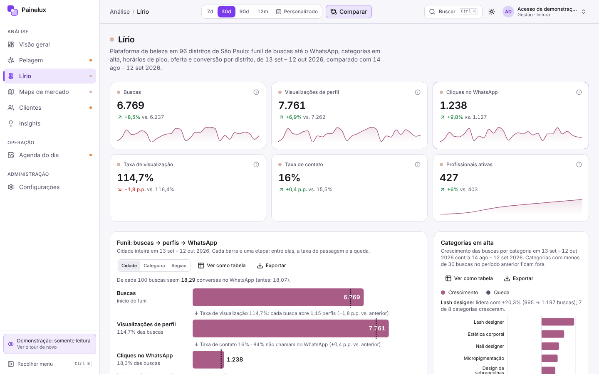 **Tema claro** |

<p align="center">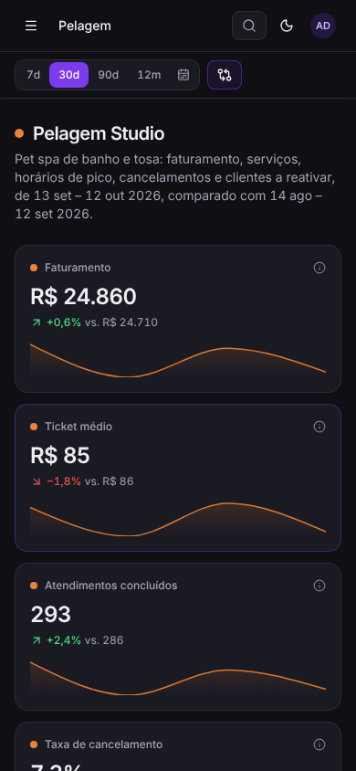</p>

## Arquitetura

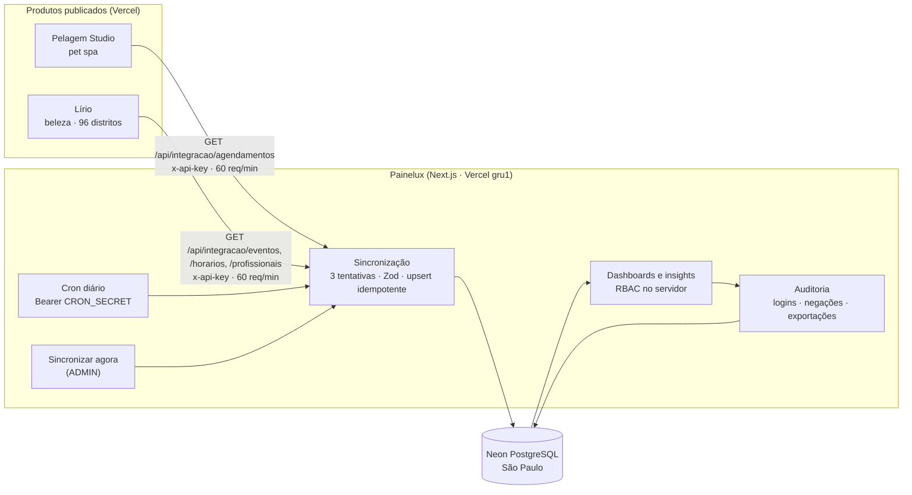

- **Nenhum dado pessoal** atravessa a integração: o Pelagem envia o cliente como `clienteHash`
  (SHA-256 com sal) e a Lírio só envia agregados por dia, distrito e categoria.
- O banco **espelha a fonte**: cada sincronização faz upsert (`INSERT … SELECT FROM unnest … ON CONFLICT`)
  e apaga, na mesma transação, o que a fonte não tem mais dentro do intervalo coberto.
- Todas as consultas são agregadas no banco, no fuso de São Paulo, e o SQL cru é sempre parametrizado.

## Stack

Next.js 16 (App Router, Server Actions, Route Handlers, Partial Prerendering) · TypeScript estrito · Tailwind CSS
+ shadcn/ui · Recharts · TanStack Table · Leaflet + OpenStreetMap · Prisma + Neon PostgreSQL · Auth.js (credenciais)
· Zod · bcryptjs · date-fns · motion · next-themes · Vitest.

## Matriz de permissões

| Permissão | ADMIN | GESTOR | ATENDENTE |
| --- | :-: | :-: | :-: |
| Visão geral, Pelagem, Lírio, Mapa de mercado, Clientes, Insights | ✓ | ✓ | — |
| Valores financeiros (faturamento, ticket) | ✓ | ✓ | — |
| Agenda do dia do Pelagem | ✓ | ✓ | ✓ |
| Exportar gráficos e tabelas (PNG e CSV) | ✓ | ✓ | — |
| Ver configurações e status das integrações | ✓ | ✓ | — |
| Disparar sincronização (escrita) | ✓ | — | — |
| Usuários: ver, criar, alterar papel, desativar, redefinir senha (escrita) | ✓ | — | — |
| Logs de auditoria: ver e exportar | ✓ | — | — |

A conta de demonstração é GESTOR **somente leitura**: perde toda permissão de escrita, seja qual for o papel.
A matriz fica em `src/lib/permissoes.ts` e é a única fonte de verdade: páginas (`requirePermission`), Route
Handlers (`requirePermissionApi`), Server Actions e o menu consultam a mesma função `can()`. Cada negação vai para
a auditoria. O que o ATENDENTE vê nunca inclui valores: a agenda nem lê do banco as colunas em centavos.

## Métricas

Definidas em um só lugar (`src/lib/metrics.ts`) e cobertas por testes.

| Métrica | Definição |
| --- | --- |
| Ticket médio | faturamento ÷ atendimentos concluídos |
| Taxa de cancelamento | cancelados ÷ todos os agendamentos do período |
| Taxa de retorno | clientes com 2+ atendimentos concluídos no período ÷ clientes atendidos |
| Cliente inativo | último atendimento concluído há mais de 30 dias e nenhuma volta agendada |
| Taxa de visualização | visualizações de perfil ÷ buscas (passa de 100% quando cada busca abre mais de um perfil) |
| Taxa de contato | cliques no WhatsApp ÷ visualizações de perfil |
| Índice de demanda | buscas ÷ profissionais ativas, **em relação à cidade** na mesma categoria (1,0× = média). Acima de 1,5× é demanda reprimida; abaixo de 0,5×, excesso de oferta |

Variações de taxas aparecem em pontos percentuais; séries acima de 31 dias são semanais e usam só semanas
completas; duas grandezas no mesmo gráfico viram índice (100 = média), nunca dois eixos Y.

## Regras dos insights

Sem IA: cada regra compara o período escolhido com o anterior de mesmo tamanho e só gera uma frase quando
passa do limite e a base é grande o bastante. Todas têm testes (`src/lib/insights.test.ts`).

| Marca | Regra | Quando aparece |
| --- | --- | --- |
| Lírio | Demanda reprimida | Distrito × categoria com índice acima de 1,5× e 15+ buscas. Alta a partir de 2,5× |
| Lírio | Busca sem oferta | 10+ buscas numa categoria e distrito sem nenhuma profissional ativa |
| Lírio | Excesso de oferta | Índice abaixo de 0,5× com 3+ profissionais ativas (prioridade baixa) |
| Lírio | Categoria em alta ou em queda | Buscas +20% ou −15% contra o período anterior, com 30+ buscas antes |
| Lírio | Taxa de contato | Variação de 2+ p.p. na cidade, ou categoria convertendo abaixo de 75% da média |
| Lírio | Pico de busca | Uma janela de 3 h concentra 30%+ das buscas |
| Pelagem | Cancelamentos por dia | Cancelamentos de um dia da semana subiram 15%+, com 5+ antes. Ex.: “Cancelamentos de sábado subiram 18% no Pelagem” |
| Pelagem | Faturamento | Variação de ±10% (atendimentos para quem não vê valores) |
| Pelagem | Taxa de retorno | Variação de 5+ p.p. |
| Pelagem | Serviço em alta ou em queda | Serviço × porte com ±30% de atendimentos e 5+ antes |
| Pelagem | Clientes inativos | 5+ clientes há mais de 30 dias sem voltar e sem volta agendada |

Cada insight traz prioridade, tipo (oportunidade, risco, tendência) e um link que abre o gráfico de origem.

## Segurança

- **Login**: bcrypt (custo 12), mensagem genérica e hash fictício quando o e-mail não existe (sem enumeração),
  bloqueio de 15 min após 5 falhas e sessão absoluta de 8 h. O papel e o status são reconferidos no banco a cada
  minuto: conta desativada perde a sessão em até 1 min.
- **Conta de demonstração**: a senha é pública e a conta só lê, então ela não sofre bloqueio por tentativas
  (ninguém consegue tirar o acesso dos recrutadores). As falhas continuam na auditoria.
- **Auditoria**: logins (sucesso, falha, bloqueio), acessos negados, criação e mudança de contas, redefinição de
  senha, sincronizações e exportações, com IP e navegador. Senhas e chaves nunca entram nos logs.
- **Usuários**: o último ADMIN ativo nunca pode ser desativado nem rebaixado, e ninguém tira o próprio acesso.
  A checagem roda numa transação com `pg_advisory_xact_lock`. Senhas temporárias aparecem uma única vez.
- **Headers**: Content-Security-Policy, `X-Frame-Options: DENY`, `Referrer-Policy`, HSTS,
  `X-Content-Type-Options` e `Permissions-Policy`. A CSP usa `'unsafe-inline'` só em scripts, porque o Partial
  Prerendering serve HTML estático sem nonce por requisição (orientação da documentação do Next.js);
  o resto fica restrito ao próprio domínio, e as imagens externas, aos tiles do OpenStreetMap.
- **Integração**: chaves só em variáveis de ambiente; o cron exige `Authorization: Bearer` comparado em tempo
  constante; Zod valida cada item recebido.
- **Exportações**: toda exportação passa pela auditoria antes do download; CSV com proteção contra
  injeção de fórmulas.

## Qualidade

- **136 testes** (Vitest) nas partes de regra: métricas, insights, RBAC, bloqueio de login, sincronização
  com `fetch` simulado, gestão de usuários, filtros, seed e CSV.
- TypeScript estrito sem `any`, ESLint e Prisma com migrations versionadas.
- **Lighthouse**: tela de entrada com 95–96 em performance e 100 em acessibilidade, boas práticas e SEO;
  páginas do painel com 100 em acessibilidade e boas práticas.
- Contraste AA nos dois temas (paletas dos gráficos validadas), todo gráfico com título, descrição, “Ver como
  tabela” e exportação; animações respeitam `prefers-reduced-motion`; navegação completa por teclado.

## Rodando localmente

```bash
cp .env.example .env   # preencha DATABASE_URL, DIRECT_URL, AUTH_SECRET, chaves das APIs e senhas do seed
npm install
npm run db:deploy      # aplica as migrations
npm run db:seed        # 4 usuários e 6 meses de dados fictícios (substituídos pela primeira sincronização)
npm run dev
```

| Script | Uso |
| --- | --- |
| `npm run build` | `prisma generate` + `prisma migrate deploy` + `next build` (Vercel) |
| `npm run build:local` | build sem aplicar migrations |
| `npm test` · `npm run lint` · `npm run typecheck` | testes, lint e tipos |

Variáveis (só os nomes): `DATABASE_URL`, `DIRECT_URL`, `AUTH_SECRET`, `PELAGEM_API_URL`, `PELAGEM_API_KEY`,
`LIRIO_API_URL`, `LIRIO_API_KEY`, `CRON_SECRET`, `SEED_ADMIN_PASSWORD`, `SEED_GESTOR_PASSWORD`,
`SEED_ATENDENTE_PASSWORD`, `SEED_DEMO_PASSWORD`.

## Estrutura

```
src/
  app/(painel)/        páginas do painel (visão geral, pelagem, lirio, mercado, clientes, insights, agenda, usuarios, logs, configuracoes)
  app/api/             cron de sincronização, detalhe do distrito, exportação de logs
  components/          gráficos (cartão, mapa de calor), painel (shell, filtros, tour), mercado, pelagem, lírio
  lib/                 regras puras e testadas: metrics, insights, mercado, permissoes, usuarios, logs, agenda
  lib/dados/           consultas agregadas por página
  lib/sync/            clientes HTTP, esquemas Zod, gravação e execução da sincronização
prisma/                schema, migrations e seed determinístico
```

---

<a id="english"></a>

## English

**Painelux is a management dashboard that brings a pet spa and a beauty marketplace together**, using real data
from two live products: period-over-period KPIs, a contact funnel, a supply-and-demand map of São Paulo's 96
districts, rule-based insights, role-based access control and a full audit trail.

### [▶ Open Painelux](https://painelux.vercel.app) · sign in with **one click** on “Explorar a demonstração”

> Fictional project built for the portfolio of Victoria Fernandes Vieira (interface in Portuguese).
> Data sources: [Pelagem Studio](https://pelagem-studio.vercel.app) (pet spa) and
> [Lírio](https://lirio-estetica.vercel.app) (beauty professionals in São Paulo), two of my other projects.

**Demo access.** The “Explorar a demonstração” button signs you in as a read-only manager (credentials are also
shown on the page). A five-step tour introduces the filters, the navigation and the `Ctrl+K` command palette.
Admin-only screens (users, audit logs, sync) are shown in the screenshots above.

**What it shows**

- **Data analysis**: KPIs against the previous period, weekly revenue, day × hour heatmaps, a search → profile view
  → WhatsApp click funnel with drop-off, trending categories, district conversion ranking, a demand index per district
  and category on a Leaflet map, and 11 tested insight rules (no AI).
- **Security**: RBAC enforced on the server for every page, route and Server Action; lockout after 5 failed
  logins (except the public read-only demo account); 8-hour sessions; audit log with IP and user agent;
  CSP and security headers; formula-injection-safe CSV exports; no personal data stored.
- **Integration**: API clients with `x-api-key`, pagination, 3 retries with backoff and per-item Zod validation;
  idempotent upserts that mirror the source; daily cron plus a manual sync with history.

**Metrics.** Average ticket = revenue ÷ completed appointments · cancellation rate = cancelled ÷ all appointments ·
return rate = customers with 2+ completed visits ÷ customers served · inactive = more than 30 days since the last
completed visit with nothing booked · view rate = profile views ÷ searches · contact rate = WhatsApp clicks ÷
profile views · demand index = searches per active professional relative to the city in the same category
(above 1.5× = unmet demand, below 0.5× = oversupply).

**Architecture.** Pelagem and Lírio expose key-protected APIs → a sync job (daily cron or manual, retries, Zod)
upserts into Neon PostgreSQL (São Paulo region) → server-rendered dashboards with RBAC and an audit trail. See the
Mermaid diagram above.

**Stack.** Next.js 16 (App Router, Partial Prerendering), strict TypeScript, Tailwind CSS + shadcn/ui, Recharts,
TanStack Table, Leaflet + OpenStreetMap, Prisma + Neon, Auth.js, Zod, bcryptjs, Vitest (136 tests).

**Quality.** Lighthouse: sign-in page 95–96 performance and 100 accessibility, best practices and SEO; dashboard
pages 100 accessibility and best practices. WCAG AA contrast in both themes, every chart has a title, a description,
a table view and PNG/CSV export, and motion respects `prefers-reduced-motion`.
